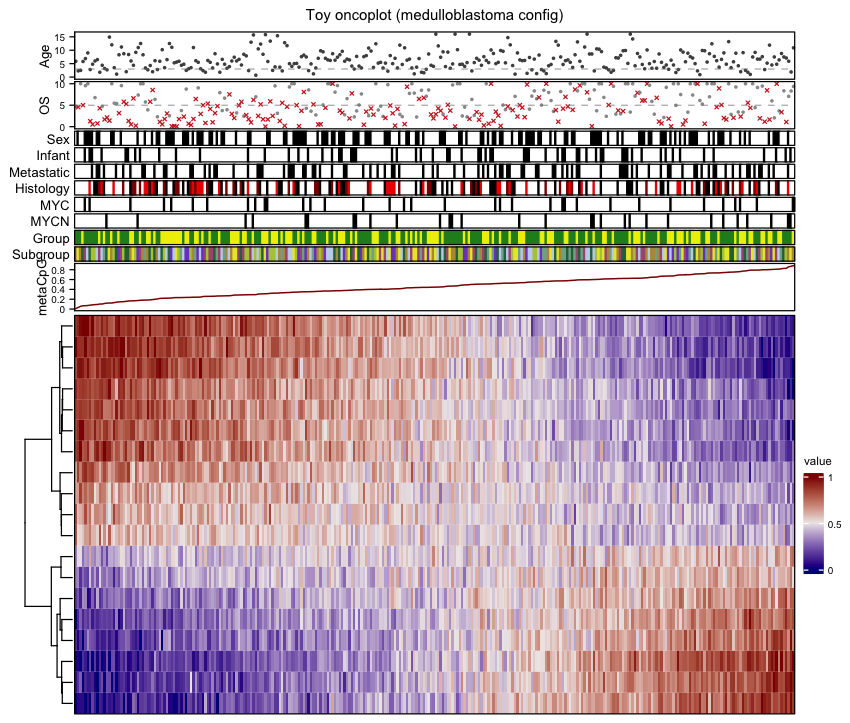
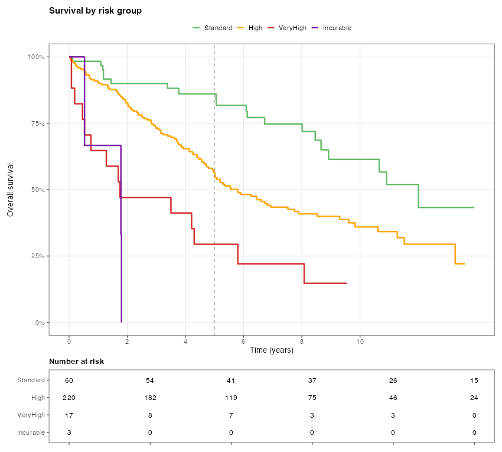

# prognostk — generic prognostic figures, metrics & risk stratification

A **configuration-driven** toolkit for survival / biomarker prognosis studies, in
both **R** and **Python**. It generalises study-specific analysis and figure code for a
methylation-based prognostic signature into reusable functions that
apply to *any* cohort: nothing about the disease, the column names, the survival
horizon, the risk thresholds or the colours is hard-coded — it all comes from an
editable YAML config (or direct function arguments).

Two output families:

| Prognostic metrics | Publication figures |
|--------------------|---------------------|
| Cox modelling (uni/multivariable, strata) | Oncoplot (annotated heatmap) |
| Bootstrapped survival prediction + BCa CIs | Distribution plots (violin / box / ridge) |
| Risk-group assignment | Kaplan–Meier curves + number-at-risk |
| Data-driven cutoff optimisation | Forest plots (hazard ratios) |
| External validation (C-index, calibration) | Calibration curves + per-patient curves |

<p align="center"><em>Oncoplot and KM curve produced from the synthetic toy data with the example config:</em></p>

<p align="center">
  
  
</p>

---

## Repository layout

```
configs/prognosis/   config.template.yaml   editable data contract (start here)
                     config.example.yaml    worked, filled-in example
                     config.schema.md       every key documented
examples/prognosis/  generate_toy_data.R    synthetic, shareable toy cohort + CpG matrix
R/prognostk/         the R package  (prognostk)
prognostk/           the Python package (prognostk)
```

## The config is the interface

You describe *your* dataset once; the same config drives both languages.

```yaml
columns:
  time: OS_Time          # follow-up time
  status: OS_Status      # 1 = event, 0 = censored
  score: metaCpG         # continuous prognostic score
  covariates: [metaCpG, metastasis, "strata:ConsensusMYC"]
survival:
  horizon: 5             # time at which survival is predicted / monitored
risk_groups:
  thresholds: [0.87, 0.73, 0.35, 0.16]
  labels: ["Favorable", "Standard", "High", "VeryHigh", "Incurable"]
palettes:
  risk: {Favorable: "#2E7D32", ...}
```

See [`configs/prognosis/config.schema.md`](../../configs/prognosis/config.schema.md) for every option. Any config
value can be overridden per-call (e.g. `plot_km(data, cfg, horizon = 10)`), so functions
also work standalone with no YAML.

---

## R

```r
# install (from the repo root)
install.packages("remotes")
remotes::install_local("R/prognostk")   # or: devtools::load_all("R/prognostk")

library(prognostk)
cfg    <- load_config("configs/prognosis/config.example.yaml")
cohort <- read.csv("examples/prognosis/toy_cohort.csv")

# --- metrics -------------------------------------------------------------
fit   <- fit_cox(cohort, cfg)                       # formula from the config
pred  <- predict_survival_at_time(fit, cohort)      # 5-yr survival per patient
cohort$risk <- assign_risk_groups(pred, cfg)
ev    <- external_validate(cohort, fit, cfg)        # C-index, calibration, E/O

# --- figures -------------------------------------------------------------
plot_km(cohort, cfg, group_col = "risk", filename = "km.pdf")
plot_oncoplot(cohort, cfg,
              matrix = read.csv("examples/prognosis/toy_methylation.csv", check.names = FALSE),
              filename = "oncoplot.pdf")
```

Runnable examples (one per output type) are in
[`R/prognostk/inst/examples/`](../../R/prognostk/inst/examples/) — run them all with:

```bash
Rscript R/prognostk/inst/examples/run_all_examples.R      # writes to example_output/
```

**Function catalogue** — metrics: `fit_cox`, `predict_survival_at_time`,
`bootstrap_survival_ci`, `validate_frozen_model`, `assign_risk_groups`,
`optimise_cutoffs`, `calibration_table`, `external_validate`. Figures: `plot_km`,
`plot_distribution`, `plot_forest`, `plot_calibration`, `plot_individual_curves`,
`plot_oncoplot`, plus `theme_pub` / `prognostk_palette`.

## Python

```bash
pip install -e .               # from the repo root (installs prognostk with PODE)
```

```python
import pandas as pd, prognostk as pk

cfg    = pk.load_config("configs/prognosis/config.example.yaml")
cohort = pd.read_csv("examples/prognosis/toy_cohort.csv")

fit  = pk.fit_cox(cohort, cfg)
pred = pk.predict_survival_at_time(fit, cohort, cfg=cfg)
cohort["risk"] = pk.assign_risk_groups(pred, cfg)

pk.plot_km(cohort, cfg, group_col="risk", filename="km.pdf")
pk.plot_oncoplot(cohort, cfg,
                 matrix=pd.read_csv("examples/prognosis/toy_methylation.csv"),
                 filename="oncoplot.pdf")
```

The R examples above have no separate Python counterparts; the calls mirror one
another, so they translate directly.

The Python API mirrors the R names and arguments (lifelines for Cox/KM,
matplotlib/seaborn for figures), so a project configured once runs the same in either
language.

---

## Generating the toy data

The toy cohort is fully synthetic (survival times simulated from a Cox model where the
score drives risk) and safe to share:

```bash
Rscript examples/prognosis/generate_toy_data.R   # writes examples/prognosis/toy_cohort*.csv, toy_methylation.csv
```

## Provenance

Generalised from earlier study-specific R analysis scripts. Dataset-specific values
(column names, model terms, palettes) live only in the config
(`configs/prognosis/config.example.yaml` for the toy data), never in the package code.

## License

MIT.
